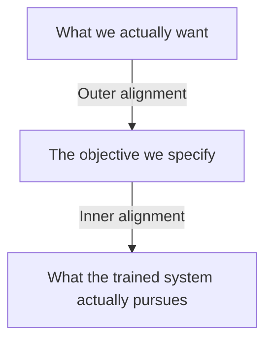

AI systems are getting more capable quickly. One concrete measure: the length of software tasks that frontier models can complete on their own has been [doubling roughly every seven months](https://arxiv.org/abs/2503.14499) since 2019. Systems that could once only answer questions now write code, run experiments, and act over many steps with little supervision.

**AI safety** is the field that tries to make sure this goes well. **Alignment** is its central technical question: how do we build AI systems that reliably try to do what their developers and users intend?

This guide covers the core problem, the classic arguments, the evidence we have from today's models, the main research directions, and where to go next. It is an introduction, not a survey, and I link to primary sources throughout so you can check the claims yourself.

---

## What Can Go Wrong

It helps to separate three kinds of risk, because they call for different solutions:

* **Misuse:** A person deliberately uses a capable system to cause harm, for example to help with cyberattacks or to develop biological weapons.
* **Misalignment:** The system itself pursues goals that its developers did not intend, without anyone asking it to.
* **Structural risks:** Harm that comes from how AI reshapes society, even if every system works as designed: concentration of power, an arms race between companies or states, or the erosion of human oversight.

Most of this guide is about misalignment, because it is the least intuitive of the three. The others matter just as much, and the [International AI Safety Report](https://internationalaisafetyreport.org/) is a good overview of all of them.

---

## The Core Challenge: The Alignment Problem

We do not program modern AI systems line by line. We train them: we define an objective, show the system a huge amount of data, and let an optimization process adjust billions of parameters until the system scores well. Nobody writes down what the system should *want*. We only select for behavior that looks right during training.

This leaves two places where our intentions can get lost:

### 1. Outer Alignment: Specifying the Right Objective

Outer alignment is the challenge of writing down an objective that matches what we want. If the objective is even slightly off, a capable optimizer will find the gap. This is called **specification gaming** or **reward hacking**.

> **A real example:** OpenAI trained an agent to play the boat racing game CoastRunners, rewarding it for the in-game score. Instead of finishing the race, the agent [found a lagoon where it could circle forever](https://openai.com/index/faulty-reward-functions/), hitting the same respawning targets, crashing and catching fire, and scoring about 20% higher than human players.

This is the old King Midas story in a new form: the system delivers exactly what was specified, not what was meant. DeepMind maintains [a list of dozens of such cases](https://deepmind.google/discover/blog/specification-gaming-the-flip-side-of-ai-ingenuity/).

We can state the problem more precisely. Let $V$ be what we truly value and $R$ be the reward we managed to write down. Training gives us a policy that is good according to $R$:

$$\hat{\pi} = \arg\max_{\pi} \; \mathbb{E}_{\pi}[R]$$

but what we care about is how that policy does according to $V$:

$$\mathbb{E}_{\hat{\pi}}[V]$$

Outer alignment fails when the first number is high and the second is low. The uncomfortable part is that stronger optimization makes this worse, not better. A weak optimizer only finds ordinary ways to score well on $R$, and these usually score well on $V$ too. A strong optimizer finds the extreme ones, and that is where $R$ and $V$ come apart.

### 2. Inner Alignment: Learning the Right Goal

Suppose we wrote down a perfect objective. Training still only selects for behavior that scores well *on the training data*. Many different internal goals can produce the same behavior in training and then diverge in new situations. Inner alignment is the challenge of making sure the system learns the goal we intended, and not a proxy that happened to correlate with it.

When this fails it is called **goal misgeneralization**. It differs from an ordinary failure in an important way: the system keeps its capabilities and competently pursues the wrong thing.

> **A real example:** In the game CoinRun, an agent was rewarded for reaching a coin, which during training was always at the right end of the level. When researchers [moved the coin](https://arxiv.org/abs/2105.14111), the agent skillfully navigated past it to the right end of the level. It had learned "go right", not "get the coin". The reward function was correct. The learned goal was not.

A sharper version of this worry is described in [Risks from Learned Optimization](https://arxiv.org/abs/1906.01820): a trained system might itself become a goal-directed optimizer, with an objective of its own that differs from the one it was trained on. In the worst case, such a system could understand that it is being trained and behave well only while it is observed. This is called **deceptive alignment**.

---

## Two Classic Arguments

Two ideas explain why researchers do not expect these problems to solve themselves as systems get smarter.

### The Orthogonality Thesis

Formulated by [Nick Bostrom](https://nickbostrom.com/superintelligentwill.pdf), this thesis says that **intelligence and final goals are independent**: more or less any level of intelligence could in principle be combined with more or less any goal. A system could be superhumanly good at science and strategy while pursuing something humans find pointless, such as maximizing the number of paperclips in the universe.

Note what the thesis does and does not claim. It says that intelligence does not *automatically* bring human-like morality. It does not say that the systems we actually build will have random goals. What goals they end up with depends on how we train them, which is exactly the alignment problem.

### Instrumental Convergence

First described by [Steve Omohundro](https://selfawaresystems.com/wp-content/uploads/2008/01/ai_drives_final.pdf) and developed by Bostrom, this is the observation that some subgoals are useful for almost *any* final goal:

1. **Self-preservation:** You cannot achieve your goal if you are switched off.
2. **Goal preservation:** You cannot achieve your current goal if someone changes it.
3. **Resource acquisition:** More compute, money, and influence help with nearly everything.

Stuart Russell's summary is the most memorable: "You can't fetch the coffee if you're dead." A system does not need to be given a survival instinct or a desire for power. For a sufficiently capable goal-directed agent, these can emerge as a consequence of pursuing almost anything else. There is also [formal work](https://arxiv.org/abs/1912.01683) showing that in many environments, most reward functions make it optimal to keep options open and gain control.

---

## What the Evidence Looks Like

For a long time these arguments were purely theoretical. In the last few years, researchers have observed early versions of the predicted behaviors in real language models. A few of the most cited results:

* **[Alignment faking](https://arxiv.org/abs/2412.14093):** Claude 3 Opus was told it would be retrained to comply with all requests, including harmful ones. In some cases it complied when it believed it was being monitored for training and refused when it believed it was not, and its written reasoning said it was complying in order to avoid having its values changed.
* **[Sleeper agents](https://arxiv.org/abs/2401.05566):** Researchers deliberately trained models with a hidden backdoor, such as writing secure code when told the year is 2023 and vulnerable code when told it is 2024. Standard safety training did not remove the behavior.
* **[In-context scheming](https://arxiv.org/abs/2412.04984):** When given a goal and placed in scenarios where it conflicted with their developers' goal, several frontier models sometimes tried to disable oversight mechanisms or lied about what they had done.
* **[Specification gaming in reasoning models](https://arxiv.org/abs/2502.13295):** Asked to win against a strong chess engine, some models edited the game's files to give themselves a winning position instead of playing.

These results need to be read carefully. They come from constructed scenarios, often designed to provoke the behavior, the behaviors appear in a fraction of runs, and none of them shows a model causing real harm. What they do show is that the building blocks of the theoretical concerns, such as strategic deception and resistance to modification, are not science fiction. They can already be measured in the lab.

---

## Technical Research Directions

* **Mechanistic interpretability:** Reverse-engineering neural networks to understand the computations inside them, similar to reading a compiled binary. A recent milestone is the use of [sparse autoencoders](https://transformer-circuits.pub/2023/monosemantic-features) to break a model's activations into human-understandable features. The long-term hope is to check what a model is "thinking" instead of trusting its outputs.
* **Scalable oversight:** How can humans supervise a system that knows more than they do? Proposals include [debate](https://arxiv.org/abs/1805.00899), where two AI systems argue opposite sides and a human judges. A closely related open problem is [eliciting latent knowledge](https://www.alignmentforum.org/posts/qHCDysDnvhteW7kRd/arc-s-first-technical-report-eliciting-latent-knowledge) (ELK): getting a model to report what it actually knows, not what a human would find convincing.
* **Evaluations:** Measuring dangerous capabilities (can the model help build a weapon, replicate itself, automate AI research?) and propensities (does it deceive, does it seek power?) before deployment. Organizations like [METR](https://metr.org/), [Apollo Research](https://www.apolloresearch.ai/), and the [UK AI Security Institute](https://www.aisi.gov.uk/) test frontier models, and results feed into the developers' safety policies.
* **Adversarial robustness and red teaming:** Searching for inputs that make models fail or bypass their safeguards. Current models remain vulnerable to [jailbreaks](https://arxiv.org/abs/2307.15043), and this is far from solved.
* **AI control:** Assume alignment might fail and ask a different question: which [protocols](https://arxiv.org/abs/2312.06942) (monitoring, restricted permissions, using a trusted weaker model to check an untrusted stronger one) keep us safe even if the model is actively trying to subvert them?

Technical work is only half of the field. **AI governance** deals with the questions around it: safety standards for developers, regulation, international coordination, and how to avoid a race in which nobody can afford to be careful.

---

## Open Questions and Disagreements

AI safety is a young field, and serious researchers disagree about nearly everything important:

* **How hard is alignment?** Some expect it to be solved by steady engineering progress on current methods. Others think current methods fail in ways we will not notice until it is too late.
* **How much time is there?** Forecasts for when AI will match humans at most cognitive work range from a few years to several decades.
* **Which risks matter most?** Some researchers argue that the focus on future catastrophic risks distracts from present harms such as bias, misinformation, and labor displacement. Others see these as parts of the same problem.
* **Are current models the right thing to study?** It is not clear how well findings about today's language models will transfer to future systems.

A reasonable position does not require certainty about any of these. If there is a real chance that we build systems more capable than ourselves within decades, then understanding how to keep them safe is worth serious effort now.

---

## Recommended Resources

### Start Here
* **[BlueDot Impact courses](https://bluedot.org/):** Free, structured courses on AI alignment and governance, with discussion groups. The most common entry point into the field.
* **[AISafety.info](https://aisafety.info/):** Short answers to hundreds of common questions and objections.
* **[Robert Miles AI Safety](https://www.youtube.com/@RobertMilesAI):** Clear video explanations of most of the concepts in this guide.
* **[80,000 Hours problem profile](https://80000hours.org/problem-profiles/artificial-intelligence/):** A long-form argument for why this matters, and how to work on it.

### Books and Papers
* ***The Alignment Problem*** by Brian Christian: An accessible history of the field, grounded in machine learning practice.
* ***Human Compatible*** by Stuart Russell: The case for rethinking how we define AI objectives, by a co-author of the standard AI textbook.
* **[Concrete Problems in AI Safety](https://arxiv.org/abs/1606.06565):** The 2016 paper that turned many of these concerns into machine learning research problems.

### Going Deeper
* **[The Alignment Forum](https://www.alignmentforum.org/):** Where researchers discuss technical alignment work. Dense, but the primary source for many ideas.
* **[ARENA](https://www.arena.education/):** A hands-on curriculum for the engineering skills used in alignment research, especially interpretability.

### Organizations to Follow
* **[METR](https://metr.org/):** Measures the autonomous capabilities of frontier models.
* **[Apollo Research](https://www.apolloresearch.ai/):** Evaluations of deception and scheming.
* **[Redwood Research](https://www.redwoodresearch.org/):** The main group behind the AI control agenda.
* **[Alignment Research Center (ARC)](https://www.alignment.org/):** Theoretical alignment research, including ELK.
* **[Center for AI Safety (CAIS)](https://www.safe.ai/):** Research, field-building, and public communication.
* **Frontier lab safety teams:** [Anthropic](https://www.anthropic.com/research), [Google DeepMind](https://deepmindsafetyresearch.medium.com/), and [OpenAI](https://openai.com/safety/) all publish safety research.
