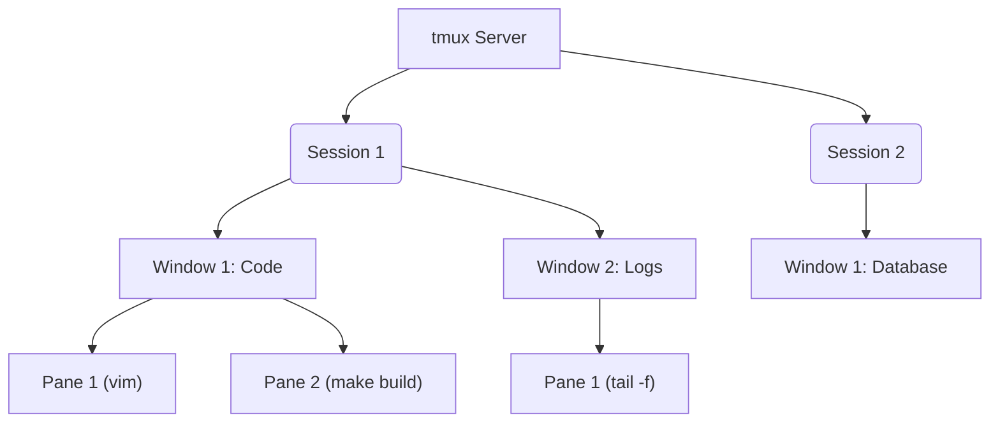

If you spend any significant time in the terminal, you’ve probably heard of **tmux** (Terminal Multiplexer). It is one of the most powerful tools in a developer's toolkit, yet it has a notoriously steep learning curve.

This guide is designed to take you from a complete tmux beginner to a power user. We will cover the core concepts, walk through everyday usage, explain the trickier parts (like scrollback and copy-paste), show you how to customize it, and wrap it all up with an easy-to-reference cheatsheet.

You don't need to install anything to follow along. There is a [practice terminal](#practice-lab) built into this page, and each section ends with a short exercise you can do in it. At the end we look at the [alternatives](#alternatives-to-tmux), mainly byobu.

---

## What is tmux and Why Do You Need It?

`tmux` stands for **Terminal Multiplexer**. It allows you to spin up multiple terminal sessions, window layouts, and split panes from a single terminal window.

Here are the three primary reasons you should use tmux:

1. **Session Persistence (Detaching/Attaching):** You can start a process on a remote server, close your laptop, commute home, reconnect to the server, and attach back to the exact state you left it.
2. **Layout Management (Panes and Windows):** You can split your screen horizontally or vertically, run your server log in one pane, code editor in another, and database console in a third.
3. **Multi-window workflow:** You can organize tasks into separate "windows" (similar to browser tabs) within a single terminal.

---

## Core Concepts: Sessions, Windows, and Panes

Before pressing any keys, it is crucial to understand the hierarchical structure of tmux:



* **Session:** A single workspace. A session persists even if you disconnect. You can have multiple sessions running simultaneously.
* **Window:** Inside a session, you can have multiple windows. Think of these as tabs in a web browser. A window takes up the entire screen.
* **Pane:** Inside a window, you can split the screen into multiple rectangular sections called panes. Each pane runs its own shell.

---

## Getting Started

### 1. Installation

Install tmux using your system's package manager:

* **macOS:** `brew install tmux`
* **Ubuntu/Debian:** `sudo apt install tmux`
* **Fedora/CentOS:** `sudo dnf install tmux`
* **Arch Linux:** `sudo pacman -S tmux`

### 2. The Prefix Key

To tell tmux that you are talking to *it* rather than the shell inside your pane, you must press a special key combination first. This is called the **Prefix Key**.

By default, the prefix key is:
$$\mathbf{Ctrl} + \mathbf{b}$$
*(Often written in documentation as `C-b`)*

**How to use shortcuts:**
To run a shortcut like `C-b c` (create window):
1. Press `Ctrl` and `b` together.
2. Release both keys.
3. Press `c` quickly.

---

<h2 id="practice-lab">Practice Lab</h2>

The terminal below is a small tmux simulator that runs in your browser. Click it, type `tmux`, and try the prefix key: after `Ctrl + b` a **PREFIX** marker appears in the status bar until you press the next key.

<link rel="stylesheet" href="/assets/tmux-lab/tmux-lab.css?v={{ buildId }}">
<div id="tmux-lab" class="tex2jax_ignore"><noscript>The practice terminal needs JavaScript. Everything else in this guide works without it.</noscript></div>
<script type="module" src="/assets/tmux-lab/tmux-lab.js?v={{ buildId }}"></script>

A few things to know before you start:

* **Exercises:** Each section below ends with a practice box. Press its start button and the terminal docks to the bottom of the window, so you can read and type at the same time. Tasks tick themselves off as you complete them, and **Hint** shows the keys if you get stuck.
* **It is a simulation:** It knows the default tmux keys and the common `tmux` commands, but it is not a real shell and it does not read a `.tmux.conf`. Type `help` to see what it understands.
* **Keyboard:** You need a physical keyboard for most of it. On a touch screen, a row of buttons below the terminal stands in for `Ctrl + b`, `Esc`, and the arrow keys. Press `Tab` to move focus out of the terminal.

---

## Session Management

Sessions are the highest level of tmux organization. You manage them using both terminal commands (from outside tmux) and shortcuts (from inside tmux).

### Terminal Commands (From Outside tmux)

| Action | Command |
| :--- | :--- |
| Start a new session | `tmux` |
| Start named session | `tmux new -s <session_name>` |
| List running sessions | `tmux ls` |
| Attach to last session | `tmux a` (or `tmux attach`) |
| Attach to named session | `tmux a -t <session_name>` |
| Rename a session | `tmux rename-session -t <old> <new>` |
| Kill a specific session | `tmux kill-session -t <session_name>` |
| Kill all sessions | `tmux kill-server` |

### Shortcuts (From Inside tmux)

Always press `C-b` before these keys:

* `$` — Rename the current session.
* `d` — Detach from the current session (leaves it running in the background!).
* `s` — Open an interactive list of all sessions to switch between them.
* `(` — Switch to the previous session.
* `)` — Switch to the next session.

<div class="tmux-exercise tex2jax_ignore" data-lab="sessions"></div>

---

## Window Management

Windows act like tabs. You use them to separate completely different tasks (e.g., one window for backend code, one for frontend, one for deployment).

Always press `C-b` before these keys:

* `c` — Create a new window.
* `,` — Rename the current window.
* `n` — Move to the **n**ext window.
* `p` — Move to the **p**revious window.
* `0` to `9` — Switch to window by index number.
* `w` — Choose a window interactively from a list.
* `&` — Kill (close) the current window.
* `f` — Find window by name.

<div class="tmux-exercise tex2jax_ignore" data-lab="windows"></div>

---

## Pane Management

Panes let you split your workspace screen. This is where the power of tmux really shines.

Always press `C-b` before these keys:

### Splitting and Closing

* `%` — Split pane **vertically** (splits left/right).
* `"` — Split pane **horizontally** (splits top/bottom).
* `x` — Close (kill) the current pane.

### Navigation

* `o` — Rotate focus through all panes in the current window.
* `Arrow Keys` — Navigate to the pane in the direction of the arrow.
* `;` — Toggle back to the last active pane.
* `q` — Show pane numbers briefly (press a number to jump directly to that pane).

### Layout and Resizing

* `z` — **Zoom/Unzoom** the current pane. (Expands it to take up the full window; press `C-b z` again to shrink it back).
* `Ctrl + Arrow Keys` — Resize the current pane in directions of arrows (increments of 1 cell).
* `Alt + Arrow Keys` — Resize the current pane in directions of arrows (increments of 5 cells).
* `Spacebar` — Cycle through default tmux pane layouts (even-horizontal, even-vertical, main-horizontal, main-vertical, tiled).
* `!` — Convert the current pane into a brand new window.
* `join-pane -t :<window_index>` — (Run in tmux command mode: `Prefix + :`) Joins current pane to another window.

<div class="tmux-exercise tex2jax_ignore" data-lab="panes"></div>

---

## Copy Mode & Scrollback

If you try to scroll up in tmux using your mouse wheel or touchpad, you will quickly notice that it either doesn't work or scrolls your terminal emulator's buffer instead of the tmux active window.

To scroll and copy text, tmux uses **Copy Mode**.

### 1. Entering Copy Mode
Press `C-b [` to enter copy mode. A counter will appear in the top-right corner showing your position in the scrollback buffer.

### 2. Navigating
tmux has two sets of copy-mode keys, Emacs-style and vi-style. It picks vi automatically when your `$EDITOR` or `$VISUAL` contains "vi", and Emacs otherwise. Most developers prefer **vi** mode and set it explicitly (see the configuration below). In both, you can navigate the buffer using:
* `Up / Down / Left / Right` arrows.
* `PageUp / PageDown` to scroll by page.

*With vi keys:*
* `k` / `j` / `h` / `l` — Move cursor up / down / left / right.
* `w` / `b` — Jump forward / backward by word.
* `g` — Go to top line.
* `G` — Go to bottom line.
* `/` — Search forward.
* `?` — Search backward.

### 3. Copying and Pasting

1. Move your cursor to the start of the text you want to copy.
2. Press `Spacebar` to start selection (`Ctrl + Space` with Emacs keys).
3. Use navigation keys to highlight the text.
4. Press `Enter` to copy the text into the tmux buffer (`Alt + w` with Emacs keys).
5. Exit copy mode by pressing `q` or `Escape`.
6. To paste the copied text elsewhere in tmux, press:
   $$\mathbf{Ctrl} + \mathbf{b} \quad \text{then} \quad \mathbf{]}$$

<div class="tmux-exercise tex2jax_ignore" data-lab="copy"></div>

---

## Customizing tmux (`.tmux.conf`)

tmux is highly customizable. You configure it by creating a file named `.tmux.conf` in your home directory (`~/.tmux.conf`).

Here is a recommended, clean config file containing the most popular quality-of-life adjustments.

```tmux
# ==========================================
# ~/.tmux.conf
# ==========================================

# 1. Change prefix from Ctrl+b to Ctrl+a (Many find Ctrl+a easier to reach)
unbind C-b
set-option -g prefix C-a
bind-key C-a send-prefix

# 2. Enable mouse support (Allows clicking to select panes, resizing, and scrolling)
set -g mouse on

# 3. Use vi-keys in copy mode
set-w -g mode-keys vi

# 4. Easy config reload shortcut
bind r source-file ~/.tmux.conf \; display-message "tmux config reloaded!"

# 5. Start window and pane numbering at 1 (instead of 0)
set -g base-index 1
setw -g pane-base-index 1

# 6. Improve colors
set -g default-terminal "screen-256color"

# 7. Split panes using visual | and -
bind | split-window -h
bind - split-window -v
unbind '"'
unbind %

# 8. Switch panes using Alt-arrow without prefix
bind -n M-Left select-pane -L
bind -n M-Right select-pane -R
bind -n M-Up select-pane -U
bind -n M-Down select-pane -D

# 9. Increase scrollback buffer limit
set -g history-limit 10000
```

### Applying Changes
To apply configuration changes without restarting tmux, press `Prefix + :` to enter command mode, type `source-file ~/.tmux.conf`, and press `Enter`. (Or press `Prefix + r` if you copied the config above).

---

## The Ultimate tmux Cheatsheet

Here is a quick-reference table summarizing everything. Keep this bookmarked!

### Session Operations

| Shortcut | Description |
| :--- | :--- |
| `tmux` | Start a new session |
| `tmux new -s <name>` | Start a new session named `<name>` |
| `tmux a` | Attach to the last active session |
| `tmux a -t <name>` | Attach to session named `<name>` |
| `tmux ls` | List all active sessions |
| `C-b d` | Detach from the current session |
| `C-b s` | Interactively list and switch sessions |
| `C-b $` | Rename current session |

### Window Operations (Tabs)

| Shortcut | Description |
| :--- | :--- |
| `C-b c` | Create a new window |
| `C-b ,` | Rename current window |
| `C-b n` | Switch to next window |
| `C-b p` | Switch to previous window |
| `C-b 0..9` | Switch to window by index |
| `C-b w` | Select window interactively |
| `C-b &` | Close current window |

### Pane Operations (Splits)

| Shortcut | Description |
| :--- | :--- |
| `C-b %` | Split vertically (left/right) |
| `C-b "` | Split horizontally (top/bottom) |
| `C-b o` | Switch to next pane |
| `C-b <Arrow>` | Switch pane in direction of arrow |
| `C-b z` | Zoom current pane to full screen |
| `C-b x` | Close current pane |
| `C-b !` | Convert pane into a new window |
| `C-b Ctrl+<Arrow>` | Resize pane by 1 cell |
| `C-b Alt+<Arrow>` | Resize pane by 5 cells |
| `C-b Space` | Cycle through default pane layouts |

### Copy Mode Operations

| Shortcut | Description |
| :--- | :--- |
| `C-b [` | Enter Copy Mode |
| `q` | Exit Copy Mode |
| `Space` (Emacs keys: `Ctrl+Space`) | Start selecting text |
| `Enter` (Emacs keys: `Alt+w`) | Copy selected text |
| `C-b ]` | Paste copied text |

---

## Pro-Tips for Power Users

1. **Tmuxinator:** If you have complex project setups (e.g., starting a database, runner, log tailer, and editor), check out [Tmuxinator](https://github.com/tmuxinator/tmuxinator). It lets you define layouts in YAML and boot them up with a single command.
2. **Tmux Resurrect & Continuum:** If your machine restarts, you lose your tmux environment. Plugins like [tmux-resurrect](https://github.com/tmux-plugins/tmux-resurrect) and [tmux-continuum](https://github.com/tmux-plugins/tmux-continuum) automatically save and restore your session layouts, open directories, and running programs.
3. **Control Mode (`tmux -CC`):** This runs tmux under control mode, allowing terminal emulators like iTerm2 or Alacritty to integrate directly with tmux. You can use native macOS windows/tabs, but they run inside tmux on the remote server!

---

<h2 id="alternatives-to-tmux">Alternatives to tmux</h2>

tmux is the default choice, but it is not the only one. The tools below all solve the same problem (many terminals, one window, sessions that survive a disconnect) with different trade-offs.

| Tool | Written in | How you drive it | Pick it when |
| :--- | :--- | :--- | :--- |
| **tmux** | C | Prefix key (`Ctrl+b`) | You want the standard that is installed everywhere and scripts well |
| **byobu** | Shell, on top of tmux | Function keys, plus a `Ctrl+a` prefix | You want tmux with friendly defaults and no config file |
| **GNU Screen** | C | Prefix key (`Ctrl+a`) | You are on an old server where nothing else is installed |
| **Zellij** | Rust | Modes, with the keys shown on screen | You want to discover features without memorising anything |
| **herdr** | Rust | tmux-style prefix keys | You run several AI coding agents side by side |
| **TUIOS** | Go | Vim-like modes, `Ctrl+b` prefix | You want a tiling window manager inside the terminal |

### Byobu

[Byobu](https://www.byobu.org/) is not a separate multiplexer. It is a layer of configuration and helper scripts that runs **on top of tmux** (or on top of GNU Screen, if you start it as `byobu-screen`). You get tmux's sessions, windows, and panes, with three things added:

1. **Function-key shortcuts.** One key press instead of a prefix and a key: `F2` opens a window, `F3` and `F4` move between windows, `F6` detaches.
2. **A status bar with system information.** Out of the box it shows things like the hostname, uptime, load, memory, and the time. Press `F9` to choose what appears there.
3. **Sensible defaults.** A large scrollback, session reuse, and a help screen (`Shift + F1`) without writing a line of config.

Byobu started at Ubuntu and is installed by default on Ubuntu Server. Elsewhere:

* **Ubuntu/Debian:** `sudo apt install byobu`
* **macOS:** `brew install byobu`
* **Fedora:** `sudo dnf install byobu`

Start it with `byobu`. Running `byobu` again later reattaches to the session you left, so there is no separate attach command to remember. If you want every SSH login to land in byobu automatically, run `byobu-enable` once (and `byobu-disable` to undo it).

| Action | tmux | byobu |
| :--- | :--- | :--- |
| New window | `C-b c` | `F2` |
| Previous / next window | `C-b p` / `C-b n` | `F3` / `F4` |
| Rename window | `C-b ,` | `F8` |
| Split top/bottom | `C-b "` | `Shift+F2` |
| Split left/right | `C-b %` | `Ctrl+F2` |
| Move between panes | `C-b <Arrow>` | `Shift+<Arrow>` |
| Resize pane | `C-b Ctrl+<Arrow>` | `Shift+Alt+<Arrow>` |
| Zoom pane | `C-b z` | `Shift+F11` |
| Close pane | `C-b x` | `Ctrl+F6` |
| Scrollback / copy mode | `C-b [` | `F7` |
| Detach | `C-b d` | `F6` |
| New session | `tmux new` | `Ctrl+Shift+F2` |
| Settings menu | edit `~/.tmux.conf` | `F9` |
| Help | `C-b ?` | `Shift+F1` |

Three things are worth knowing before you switch:

* **Everything you learned above still works.** Byobu changes the prefix from `Ctrl+b` to `Ctrl+a`, so `Ctrl+a c`, `Ctrl+a %`, `Ctrl+a d`, and the rest behave exactly as in tmux. The first time you press `Ctrl+a`, byobu asks whether you want it as the prefix or as the shell's "go to start of line"; `byobu-ctrl-a` changes the answer later.
* **Function keys can collide with other programs.** Tools like `htop` and Midnight Commander use the same keys. `Shift + F12` turns byobu's function keys off and on again.
* **Your own settings go in `~/.byobu/`.** tmux options belong in `~/.byobu/.tmux.conf` and key bindings in `~/.byobu/keybindings.tmux`, not in `~/.tmux.conf`.

You can try the function keys in the practice terminal:

<div class="tmux-exercise tex2jax_ignore" data-lab="byobu"></div>

*Your browser or operating system may keep a few function keys for itself. If one does nothing, press `Ctrl + a` and use the tmux key instead.*

### GNU Screen

[GNU Screen](https://www.gnu.org/software/screen/) is the original, first released in 1987, and the tool tmux was written to replace. It is still maintained and still preinstalled on a lot of older machines, so it pays to know the handful of keys that get you out of trouble. The prefix is `Ctrl+a`.

| Action | Command or key |
| :--- | :--- |
| Start a named session | `screen -S <name>` |
| List sessions | `screen -ls` |
| Reattach | `screen -r <name>` |
| Detach | `C-a d` |
| New window | `C-a c` |
| Next / previous window | `C-a n` / `C-a p` |
| Split top/bottom | `C-a S` |
| Split left/right | <code>C-a &#124;</code> |
| Move to the next region | `C-a Tab` |
| Scrollback / copy mode | `C-a [` |

Splits are where Screen shows its age: a new region starts empty, and you have to move into it and create or select a window yourself. One thing it does that tmux does not is talk to serial ports, for example `screen /dev/ttyUSB0 115200`, which keeps it popular with people who work on routers and microcontrollers.

### Zellij

[Zellij](https://zellij.dev/) is a newer multiplexer written in Rust. Its main idea is that you should not need a cheatsheet: a bar at the bottom of the screen always shows which keys do what. Instead of a prefix, you enter a **mode**, such as `Ctrl+p` for panes, `Ctrl+t` for tabs, `Ctrl+n` for resizing, `Ctrl+s` for scrolling, and `Ctrl+o` for sessions, and then press a single letter (`Ctrl+p` then `r` opens a pane to the right, `Ctrl+o` then `d` detaches).

It also has floating panes, layouts defined in files, sessions you can resurrect after a reboot, and a plugin system based on WebAssembly. Install it with `brew install zellij` or `cargo install --locked zellij`, start it with `zellij`, and come back with `zellij attach`. The cost is that it is rarely preinstalled on servers, and its mode keys can clash with shortcuts in the programs you run inside it (there is a "locked" mode, `Ctrl+g`, for that).

### herdr

[herdr](https://herdr.dev/) is a multiplexer built for running AI coding agents such as Claude Code, Codex, Cursor, and opencode. It is a single Rust binary that keeps your terminals running in a background server, like tmux, and it uses tmux-style prefix keys: `Ctrl+b q` detaches and running `herdr` again reattaches.

What it adds is awareness of what is running inside each pane. Every pane is marked as working, blocked, or idle, so with five agents going you can see at a glance which one is waiting for your answer. Agents can also drive it themselves through a command-line interface and socket API, for example to open a pane for a sub-task. Install it with `brew install herdr` or the install script on its site. If you only run one shell per pane, plain tmux does the same job.

### TUIOS

[TUIOS](https://github.com/Gaurav-Gosain/tuios) ("Terminal UI Operating System") is a terminal window manager and multiplexer written in Go. It feels more like a tiling desktop than like tmux: nine workspaces, automatic tiling layouts, and full mouse support for dragging and resizing windows.

It is modal, in the style of Vim. In *window management mode* you press `n` for a new window and `i` or `Enter` to start typing into one; `Ctrl+b` is the prefix for everything else, so `Ctrl+b d` detaches and `Ctrl+b Space` toggles tiling. Sessions are kept alive by a daemon (`tuios new <name>`, `tuios attach <name>`, `tuios ls`). Install it with `brew install tuios`. It is a young project that changes quickly, so check its documentation for the current keys.

### Which One Should You Learn?

Learn **tmux** first. It is what you will find on servers, in tutorials, and in other people's dotfiles, and both byobu and herdr build on its vocabulary. Add **byobu** if you would rather press `F2` than remember a prefix, or if you want a useful status bar without configuring one. Try **Zellij** if tmux never clicked for you. Keep the five Screen keys in the back of your head for the day you land on a machine that has nothing else.

Now go ahead, open your terminal, type `tmux`, and start experimenting!
